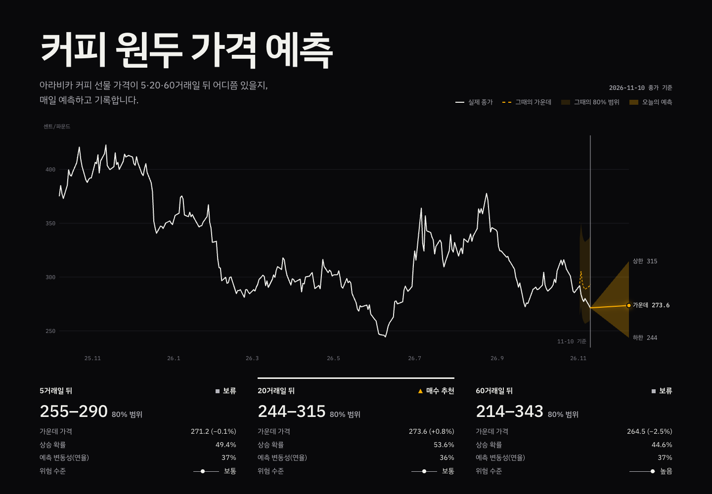
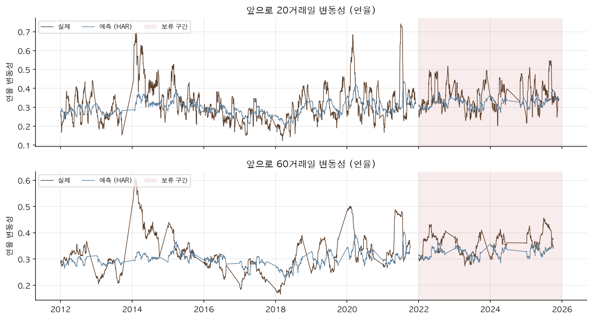
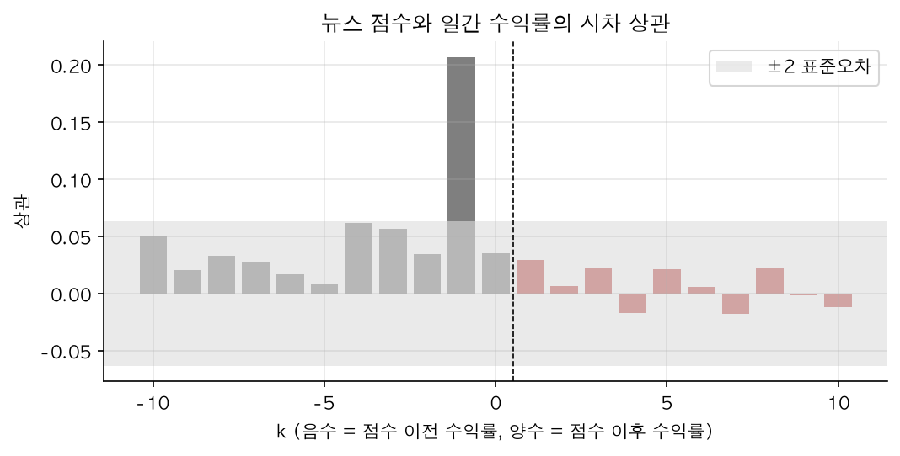
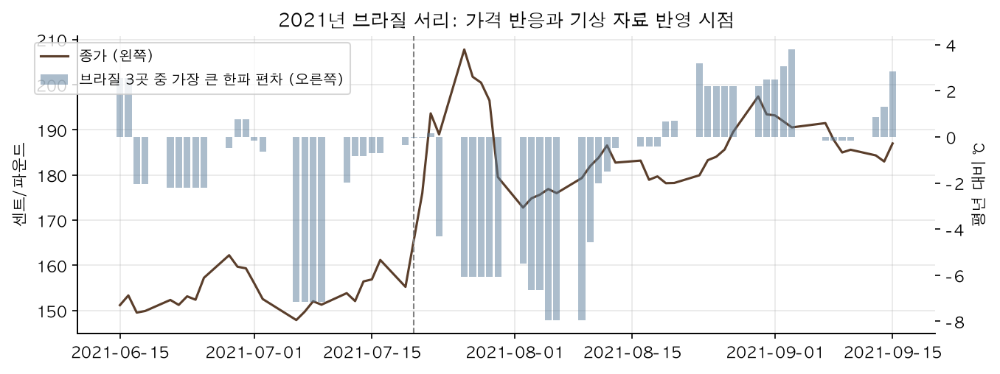
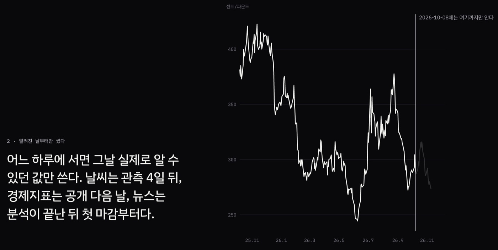
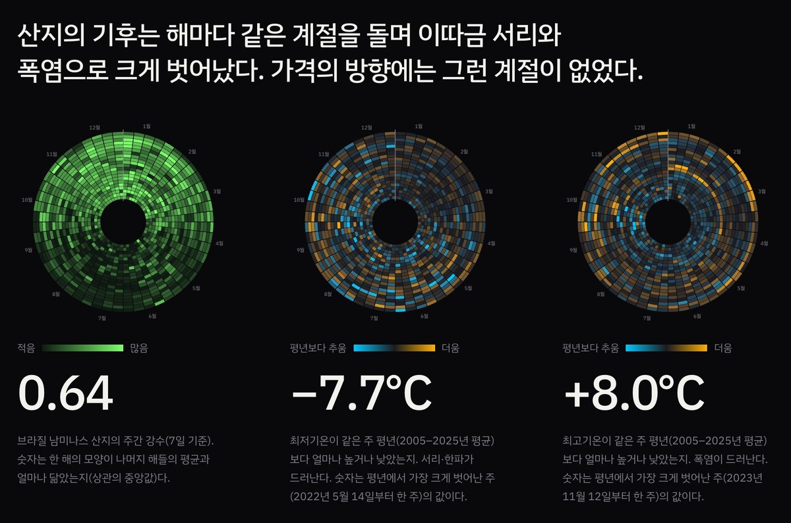
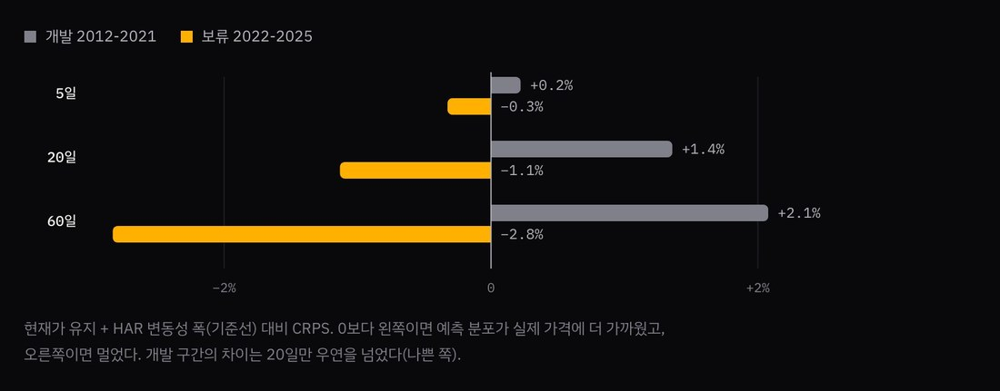
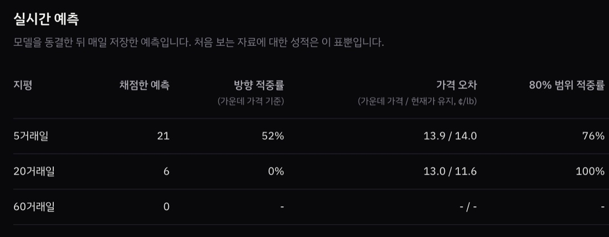
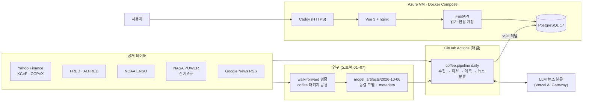

# 커피 선물 가격 범위 예측

> 아라비카 커피 선물(KC=F)이 **5·20·60거래일 뒤 어느 가격 범위에 있을지** 매일 예측해 공개하는 1인 데이터 프로젝트입니다. 데이터 수집, 탐색 분석, 실험 설계와 검증, 자동화 파이프라인, 대시보드 운영까지 혼자 진행했습니다.

**[▶ 운영 대시보드](https://coffee-price-sjinie.koreacentral.cloudapp.azure.com/)** · [일일 배치 실행 기록](https://github.com/sjinie/Coffee_Price_Prediction/actions/workflows/daily.yml) · [분석 노트북](notebooks/) · [개발 기록](docs/development_log.md) · [구조와 데이터 계약](docs/architecture.md)

## 한눈에 보기

| 변동성 예측 오차 | 80% 예측 범위 적중률 | 60일 상승 확률 AUC | 운영 |
|:---:|:---:|:---:|:---:|
| **−25%** | **82%** | **0.64** | **매일 자동** |
| 직전 변동성을 그대로 쓸 때 대비 RMSE (5일) | 목표 80% · 2012–2021<br/>2022–2025는 74–79% | 0.5가 무작위 수준<br/>2022–2025에서도 0.63 | 2026-10-05부터 |

**결론.** 시험한 모델은 미래 가격을 "현재가 유지"보다 정확하게 맞히지 못했습니다. 반면 가격이 얼마나 크게 움직일지(변동성)는 5·20거래일에서 기준선보다 잘 예측됐습니다. 그래서 가격 하나를 맞히는 대신 **80% 예측 범위**(실제 가격이 열 번 중 여덟 번 들어가도록 잡은 범위)를 내도록 목표를 바꿨고, 그 예측을 매일 기록해 채점하고 있습니다.

[](https://coffee-price-sjinie.koreacentral.cloudapp.azure.com/)

*2026-11-11 운영 화면. 2026-11-10 종가 기준 20거래일 뒤 80% 범위는 244–315센트/파운드, 상승 확률은 53.6%입니다. 이미지를 누르면 현재 대시보드로 이동합니다.*

| | |
|---|---|
| **문제** | 카페는 원두를 몇 주에서 몇 달 앞서 계약한다. 필요한 것은 가격 하나가 아니라 **가격이 움직일 범위와 오를 가능성**이다 |
| **데이터** | 2005년부터의 가격·환율·금리·유가·운임, 산지 6곳 기상, ENSO(엘니뇨·라니냐 지수), 뉴스 1,446건. 공개 데이터 5종에서 피처 67개 |
| **방법** | 그날 알 수 있던 정보만 쓰는 시점 규칙, 해마다 그 전까지로 학습해 그해를 예측하는 검증(walk-forward), 기준선 비교, 계산 전에 적어 둔 판단 규칙 |
| **결과물** | 80% 가격 범위·상승 확률·매수 신호·위험 수준을 내는 분포 모델과, 예측 근거·검증 성적·실시간 적중 기록을 보여 주는 대시보드 |
| **역할·기간** | 1인 · 2026-09-12 – 10-06 개발, 이후 매일 운영 중 (2025년 학부 캡스톤을 처음부터 재설계) |
| **스택** | Python · pandas · scikit-learn · LightGBM · SciPy · PostgreSQL · FastAPI · Vue 3 · Docker · GitHub Actions · Azure |

## 분석에서 찾은 것

| 질문 | 발견 | 결정 |
|---|---|---|
| 가격을 맞힐 수 있는가 | Ridge·LightGBM·LSTM 모두 "현재가 유지" 기준선을 넘지 못했다. 단순 LSTM은 20일 RMSE가 기준선보다 17.1% 컸다 | 가격 하나를 맞히는 대신 **범위와 위험**을 예측하도록 목표를 바꿨다 |
| 변동성은 예측되는가 | 최근 5·20·60일 변동성으로 다음 변동성을 예측하는 HAR 모델이, 직전 변동성을 그대로 쓰는 것보다 RMSE를 5일 25%, 20일 14% 줄였다. 2022–2025에도 27%, 20%. 60일은 차이가 뚜렷하지 않았다. 2022–2025에서는 평균 수준을 더 잘 맞춘 효과였고, 급등락 시점을 맞힌 것은 아니다 | 예측 범위의 폭을 변동성 예측으로 정한다 |
| 뉴스가 가격을 앞서는가 | 뉴스 점수는 기사 **당일** 수익률과 상관 0.21, 이후 수익률과는 뚜렷한 관계가 없었다 | 뉴스는 가격을 따라간다고 보고 보조 입력 1개로만 쓴다 |
| 기후는 어떻게 넣는가 | 2021년 브라질 서리 때 평균기온은 평년보다 0.7℃ 낮았을 뿐이지만 최저기온은 5℃ 안팎 낮았다 | 기온·강수를 값 그대로가 아니라 직전 10년 같은 시기 대비 **편차**로 넣는다 |
| 원자료를 믿을 수 있는가 | 1,910 안팎이던 페소 환율이 하루만 3.67로 잘못 기록돼 있었다. 이 값 하나가 60일 예측 분포의 폭을 정하는 σ를 61,083까지 키웠다. 흔한 IQR 1.5배 이상치 규칙은 페소 일간 변화의 7.9%를 이상치로 잡았다 | 실제 자료로 규칙을 비교해 정했다(IQR 20배). 바뀐 값은 18개뿐이다 |
| 앙상블이 돕는가 | 9월 실험에서 60일 모델 둘의 평균은 단일 모델보다 RMSE가 검증에서 5.76% 낮았지만 테스트에서는 2.63% 높았다 | 이득이 재현되지 않아 기각했다 |

| 변동성: 예측(파랑)은 실제의 평균 수준을 따라가고 급등은 잡지 못한다 | 뉴스: 당일에만 반응하고 이후는 0 근처 |
|---|---|
|  |  |



*2021년 7월 브라질 서리. 가격(선)이 급등한 시기에 최저기온이 평년보다 크게 낮았습니다(막대).*

분석 과정은 노트북 [01 탐색](notebooks/01_data_and_eda.ipynb) → [02 피처 선택](notebooks/02_feature_selection.ipynb) → [03 수익률·방향](notebooks/03_return_direction.ipynb) → [04 변동성](notebooks/04_volatility.ipynb) → [05 뉴스](notebooks/05_news_signal.ipynb) → [07 분포 모델](notebooks/07_distribution_model.ipynb) 순서로 볼 수 있습니다. 수익률 재설계는 [03b](notebooks/03b_return_redesign.ipynb), 뉴스 보정 재시험은 [05b](notebooks/05b_news_correction.ipynb)에 있습니다.

## 개발 과정

처음부터 지금 구조였던 것은 아닙니다. 방향을 바꾼 순간만 추렸고, 전체는 [개발 기록](docs/development_log.md) 31건에 있습니다.

| 시기 | 한 일 | 알게 된 것과 바꾼 것 |
|---|---|---|
| 2025 학부 캡스톤 | Attention-LSTM으로 14일 뒤 가격 예측 | 다시 보니 비교할 기준선이 없었고, 테스트 손실을 보며 튜닝했으며, 결측을 미리 채워 미래 정보가 섞였다. 평가 방법부터 다시 설계하기로 했다 |
| 2026-09 | 2014년부터의 자료로 6개 모델 비교, 뉴스를 넣는 방법 4가지 시험 | 가장 좋은 모델이 평가 기간마다 달라졌고 앙상블은 검증에서만 좋았다. 뉴스는 네 방법 모두 이득이 없었다 |
| 09-27 – 10-01 | 일일 배치가 5회 연속 실패 | 4회는 보조 뉴스 소스 하나가 차단(HTTP 403)되자 뉴스 수집 단계가 통째로 멈춘 것이고, 1회는 SSH 시간 초과였다. 보조 소스 실패는 경고로 분리하고 SSH는 재시도하게 했다 |
| 10-03 | 전면 재작성과 검증 재설계 | 빠르게 키운 서비스 코드 7,500줄에 채택하지 않은 실험 경로와 설명하기 어려운 코드가 섞여 있었다. 이전 코드는 기록으로 남기고, 읽고 설명할 수 있는 코드를 기준으로 다시 썼다. 새 코드의 첫 비교에서도 방향 정확도가 50% 근처여서, 자료를 2005년까지 늘리고 검증을 연도별 walk-forward로 바꿨다 |
| 10월 초 | 외부 코드 리뷰에서 평가 표본 누락 발견 | 60일 예측 평가에서 해마다 10–12월이 빠져 있었다. 설정을 그대로 두고 빠진 행만 넣자 2022–2025 60일 방향 AUC가 0.655에서 0.601로 내려갔다. 노트북 02–06을 다시 실행해 설정을 처음부터 다시 골랐다 |
| 10-05 – 06 | 수익률 예측 재설계, 분포 모델 v1 실패, v2 동결 | 설정 선택까지 과거 자료로만 하도록 바꿔도(중첩 검증) "현재가 유지"보다 낫다고 할 예측 기간이 없어, 범위를 주 출력으로 정했다. 분포 모델 v1은 환율 값 오류, 과거 평균 추세를 미래에 더한 상수항, 좁게 잡힌 범위 때문에 실패했고, 세 원인을 고친 v2를 서비스 모델로 동결했다 |
| 10-05 – | 매일 운영 | 실시간 예측을 쌓아 채점하고 있다. 11월에 외부 리뷰 2건을 코드로 대조해 반영했다 |
## 대시보드

한 페이지에서 예측, 예측이 만들어지는 과정, 데이터·모델 선택의 근거, 실시간 적중 기록을 차례로 보여 줍니다.

| 작동 방식: 그날 알 수 있던 값만 쓴다 | 데이터 탐색: 산지 기후를 연도 × 52주 원형 차트로 |
|---|---|
|  |  |
| **검증 결과: 기준선 대비 성적 공개** | **적중 기록: 실시간 예측을 따로 채점** |
|  |  |

화면은 2026-11-11에 운영 사이트에서 캡처했습니다. 실시간 채점은 2026년 10월에 시작해 표본이 아직 작습니다(캡처 시점 5거래일 22건, 20거래일 7건, 60거래일 0건).

## 검증 방법과 모델 성적

**예측 대상.** 기준일 종가 대비 h거래일 뒤 종가의 로그수익률 ln(P<sub>t+h</sub> / P<sub>t</sub>) 분포입니다. h는 5·20·60이고, 화면에서는 이 예측 기간을 '지평'이라고 부릅니다.

| 구간 | 기간 | 쓰임 |
|---|---|---|
| 개발 | 2012–2021 | 해마다 그 전까지로 학습해 그해를 예측(walk-forward 10회). 후보와 판단 규칙을 여기서 정한다 |
| 홀드아웃 (화면의 '보류') | 2022–2025 | 개발 구간에서 정한 규칙을 그대로 적용해 확인한다. 앞선 실험에서 이미 본 구간이라 참고 성적으로만 쓴다 |
| 실시간 | 2026-10– | 동결한 모델의 매일 예측을 대시보드에서 채점한다. 처음 보는 자료에 대한 성적은 이것뿐이다 |

- **기준선과 비교합니다.** 수익률은 현재가 유지, 변동성은 직전 변동성, 범위는 현재가에 HAR 변동성 폭을 더한 것이 기준선입니다. 모든 성적은 같은 날짜·같은 예측 기간의 기준선과 비교합니다.
- **미래 정보를 막습니다.** 목표일이 학습 구간을 넘는 행은 학습에서 빼고(embargo), 모델 설정은 평가 연도 이전 성적으로만 고릅니다(중첩 검증).
- **불확실성을 함께 냅니다.** h일 수익률은 날짜가 겹쳐 서로 독립이 아니므로 블록 bootstrap 1,000회로 95% 구간을 계산합니다.
- **판단 규칙을 먼저 적습니다.** 후보와 채택 기준을 계산 전에 노트북 첫 셀에 적고 해시(SHA-256)로 고정했습니다. 분포 모델 v2는 v1의 결과를 본 뒤 고친 것이라 개발 구간도 두 번째로 본 것입니다.

**서비스 모델 `2026-10-06`.** 예측 기간마다 가운데 값과 폭을 함께 예측하는 분포 모델 하나를 씁니다(y = μ(x) + σ(x)·Z). 범위·상승 확률·매수 신호·위험 수준이 모두 같은 분포에서 나와 서로 어긋나지 않습니다. 성적은 CRPS로 잽니다. CRPS는 예측 분포가 실제 값에서 얼마나 떨어졌는지를 나타내고 낮을수록 좋습니다.

| 예측 기간 | 80% 범위 적중률<br/>개발 / 홀드아웃 | 상승 확률 AUC<br/>개발 / 홀드아웃 | 기준선 대비 CRPS<br/>개발 / 홀드아웃 |
|---|---|---|---|
| 5일 | 82.7% / 78.2% | 0.53 / 0.52 | +0.2% / −0.3% |
| 20일 | 82.4% / 79.0% | 0.56 / 0.58 | +1.4% / −1.1% |
| 60일 | 82.1% / 74.3% | 0.64 / 0.63 | +2.1% / −2.8% |

CRPS 열은 +면 기준선보다 나쁘고 −면 좋다는 뜻입니다. 분포 모델이 기준선보다 낫다는 것은 확인되지 않았습니다. 개발 구간에서는 세 기간 모두 조금 나빴고(20일만 우연을 넘는 차이), 홀드아웃에서는 조금 좋았습니다. 기준선이 이미 HAR 변동성 폭을 쓰기 때문에 변동성 예측의 이득(5일 −25%)은 기준선에도 들어 있습니다. 분포 모델을 쓰는 이유는 범위·확률·신호를 한 모델에서 어긋남 없이 내기 위해서입니다.

매수 신호는 20일에서만 냅니다. 개발 구간 시뮬레이션에서 신호대로 사면 정기 구매보다 평균 0.16% 쌌을 뿐이고, 신호 기준을 고른 자료와 채점한 자료가 같아 그 우위도 검증된 것이 아닙니다. 그래서 화면은 신호보다 범위를 먼저 보여 줍니다.

## 데이터 파이프라인



**1. 모든 값에 "언제 알 수 있었나"를 붙였습니다.** 소스마다 실제로 쓸 수 있게 된 시점을 정하고 기준일에 이미 알려진 값만 붙입니다.

| 자료 | 언제부터 쓰는가 |
|---|---|
| KC=F 종가 (Yahoo) | 당일 23:00 UTC 마감 이후 |
| 페소 환율 COP=X (Yahoo) | 관측 다음 날 |
| 헤알 환율·금리·유가·운임 (FRED·ALFRED) | 최초 공개일 다음 날 (공개 기록이 없는 구간은 공개 지연을 가정) |
| ENSO (NOAA) | 3개월 계절이 끝난 다음 달 11일 |
| 산지 강수·기온 (NASA POWER) | 관측일 + 4일 |
| 뉴스 점수 (Google News → LLM 분류) | 분류가 끝난 뒤 첫 거래일 마감 |

"기준일 이후 원자료를 모두 바꿔도 기준일까지의 피처는 같다"는 성질을 테스트로 고정했습니다.

**2. 예측 기록은 결과를 본 뒤에 바뀌지 않습니다.** 기준일의 예측은 다음 종가가 나오기 전에 예약 배치가 확정하고 그 뒤에는 고치지 않습니다. 실시간 예측과 소급 계산은 따로 저장해 따로 채점합니다.

**3. 실패를 경고와 중단으로 나눕니다.** 종료 코드를 성공 0 / 경고 3 / 실패 1로 나눠, 뉴스 같은 보조 소스가 실패해도 예측은 저장됩니다. LLM 뉴스 분류는 하루 2건, 누적 1 USD 상한 안에서 돕니다.

**4. 연구와 서비스가 같은 코드를 씁니다.** 노트북과 일일 배치가 같은 `coffee` 패키지로 피처와 예측을 만들고, 노트북의 예측과 DB에 저장된 값이 같은지 확인했습니다. 모델은 버전으로 동결하고 파일 해시를 검사합니다.

## 역량 요약

| 역량 | 근거 |
|---|---|
| 문제 정의 | 구매자에게 필요한 값으로 예측 대상을 다시 정함 (가격 수준 → 범위·확률) |
| 데이터 품질 | 잘못 기록된 값을 찾아 원인을 추적하고, 실제 자료로 이상치 규칙을 비교해 결정 |
| 실험 설계 | 기준선, walk-forward, 중첩 검증, 블록 bootstrap, 계산 전 판단 규칙 고정 |
| 판단 | 뉴스 보정·앙상블·딥러닝처럼 좋아 보이는 후보를 근거를 들어 기각 |
| 엔지니어링 | 매일 도는 수집·예측 배치, 읽기 전용 API, 테스트 111개(pytest 89 · 프론트 22), CI |
| 전달 | 예측과 그 근거, 검증 성적을 한 화면에서 설명하는 대시보드 |

## 실행 방법

`.env.example`을 `.env`로 복사해 값을 채웁니다(`FRED_API_KEY`, `AI_GATEWAY_API_KEY`, `DATABASE_URL`, `POSTGRES_PASSWORD`).

```bash
# 환경 (Python 3.12)
uv venv --python 3.12 "$HOME/.virtualenvs/coffee-price-prediction"
uv pip install --python "$HOME/.virtualenvs/coffee-price-prediction/bin/python" -r requirements.txt
source "$HOME/.virtualenvs/coffee-price-prediction/bin/activate"

python -m pytest            # DB 없이 72 passed · COFFEE_TEST_DATABASE_URL을 주면 89 passed
python -m coffee.sources    # 원자료 수집 → data/sources/*.parquet

# 로컬 전체 실행 (PostgreSQL + API + 대시보드 → http://localhost:8080)
docker compose up -d --build
docker compose run --rm pipeline migrate
docker compose run --rm pipeline backfill
docker compose run --rm pipeline daily      # 기준일의 예약 시각(종가 다음 날 06:17 UTC) 전이면 건너뜀

# 프론트엔드
cd frontend && npm ci && npm test && npm run build
```

수집 데이터(`data/`)는 저장소에 넣지 않았습니다. 노트북은 번호 순서로 실행하되 07 다음에 06을 실행합니다(07이 고른 설정을 06이 동결). 배포 절차는 [architecture.md](docs/architecture.md#배포와-되돌리기)에 있습니다.

## 저장소 구조

```
coffee/              수집·피처·평가·모델·뉴스·DB·파이프라인·API (노트북과 서비스 공용)
notebooks/           01–07 분석 노트북과 결과 JSON
model_artifacts/     동결 모델(2026-10-06)과 metadata
frontend/            Vue 3 대시보드 (차트 라이브러리 없이 SVG)
tests/               시점 성질·평가·파이프라인·DB 계약 테스트
deploy/, .github/    VM 배포 설정, CI와 일일 배치 워크플로
docs/                architecture.md(구조·데이터 계약), development_log.md(의사결정 기록 31건)
```

## 한계와 다음 단계

- 가격 방향 신호는 약합니다. 실시간 예측이 쌓이면 범위·신호 적중률을 같은 규칙으로 다시 검증합니다.
- 2026년 구간에서 80% 범위 적중률이 62–76%로 낮아졌습니다. 범위 폭 재보정이 다음 버전의 과제입니다.
- Yahoo KC=F는 근월물 연결 가격이라 만기 교체 때의 가격 점프가 섞여 있습니다.
- KC=F는 선물 가격이라 카페의 실제 납품가와 다릅니다. 구매 판단의 참고 지표로 본 것이고, 실제 구매비가 줄어드는지는 검증하지 않았습니다.

이 프로젝트는 투자 조언이 아닙니다.
