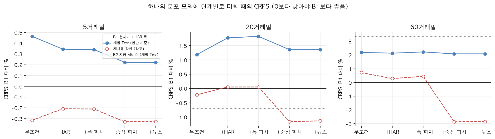
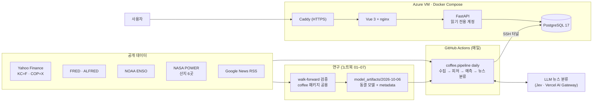

# 커피 선물 가격 범위 예측

> 아라비카 커피 선물(KC=F)이 **5·20·60거래일 뒤 어느 가격 범위에 있을지** 매일 예측해 공개하는 1인 데이터 프로젝트입니다. 데이터 수집, 탐색 분석, 실험 설계와 검증, 자동화 파이프라인, 대시보드 운영까지 직접 만들었습니다.

**[▶ 운영 대시보드](https://coffee-price-sjinie.koreacentral.cloudapp.azure.com/)** · [일일 배치 실행 기록](https://github.com/sjinie/Coffee_Price_Prediction/actions/workflows/daily.yml) · [분석 노트북](notebooks/) · [개발 기록](docs/development_log.md) · [구조와 데이터 계약](docs/architecture.md)

[](https://coffee-price-sjinie.koreacentral.cloudapp.azure.com/)

*2026-11-11 운영 화면(2026-11-10 종가 기준 예측). 이미지를 누르면 현재 대시보드로 이동합니다.*

## 한눈에 보기

| 변동성 예측 오차 | 80% 예측 범위 적중률 | 60일 상승 확률 AUC | 운영 |
|:---:|:---:|:---:|:---:|
| **−25%** | **82%** | **0.64** | **매일 자동** |
| 기준선 대비 RMSE (5일) | 목표 80%, 2012–2021 검증 | 2022–2025에서도 0.63 | 2026-10-05부터 |

| | |
|---|---|
| **문제** | 카페는 원두를 몇 주에서 몇 달 앞서 계약한다. 필요한 것은 가격 하나가 아니라 **가격이 들어갈 범위와 오를 가능성**이다 |
| **데이터** | 2005년부터의 가격·환율·금리·유가·운임, 산지 6곳 기상, ENSO, 뉴스 1,446건. 공개 데이터 5종에서 피처 67개 |
| **방법** | 그날 알 수 있던 정보만 쓰는 시점 규칙, 연도별 walk-forward 검증, 기준선 비교, 사전 등록한 판단 규칙 |
| **결과물** | 80% 가격 범위·상승 확률·매수 신호·위험 수준을 내는 분포 모델과, 예측 근거·검증 성적·실시간 적중 기록을 보여 주는 대시보드 |
| **역할·기간** | 1인 · 2026-09-12 – 10-06 개발, 이후 매일 운영 중 (2025년 학부 캡스톤을 처음부터 재설계) |
| **스택** | Python · pandas · scikit-learn · LightGBM · SciPy · PostgreSQL · FastAPI · Vue 3 · Docker · GitHub Actions · Azure |

## 분석에서 찾은 것

| 질문 | 발견 | 결정 |
|---|---|---|
| 가격을 맞힐 수 있는가 | Ridge·LightGBM·LSTM 모두 "현재가 유지" 기준선을 넘지 못했다. 단순 LSTM은 20일 RMSE가 기준선보다 17.1% 컸다 | 가격 하나를 맞히는 대신 **범위와 위험**을 예측하도록 목표를 바꿨다 |
| 변동성은 예측되는가 | HAR 모델이 직전 변동성 대비 RMSE를 5일 25%, 20일 14% 줄였다. 2022–2025에도 27%, 20% | 예측 범위의 폭을 변동성 예측으로 정한다 |
| 뉴스가 가격을 앞서는가 | 뉴스 점수는 기사 **당일** 수익률과 상관 0.21, 이후 수익률과는 관계가 없었다 | 뉴스는 가격을 따라간다고 보고 보조 입력 1개로만 쓴다 |
| 기후는 어떻게 넣는가 | 2021년 브라질 서리는 평균기온으로는 −0.7℃지만 최저기온 편차로는 −5℃ 안팎이었다 | 계절값 대신 직전 10년 같은 시기 대비 **편차**로 넣는다 |
| 원자료를 믿을 수 있는가 | 환율 오류 시세 하나(1,910 → 3.67)가 60일 예측 폭을 σ = 61,083까지 키웠다. 흔한 IQR 1.5배 규칙은 페소 일간 변화의 7.9%를 이상치로 잡았다 | 실제 자료로 규칙을 비교해 정했다(IQR 20배). 바뀐 값은 18개뿐이다 |
| 앙상블이 돕는가 | 검증 RMSE −5.76%, 테스트 +2.63% | 과적합으로 판단해 기각했다 |

| 변동성: 예측(파랑)이 실제 수준을 따라간다 | 뉴스: 당일에만 반응하고 이후는 0 근처 |
|---|---|
|  |  |


분석 과정은 노트북 [01 탐색](notebooks/01_data_and_eda.ipynb) → [02 피처 선택](notebooks/02_feature_selection.ipynb) → [03 수익률·방향](notebooks/03_return_direction.ipynb) → [04 변동성](notebooks/04_volatility.ipynb) → [05 뉴스](notebooks/05_news_signal.ipynb) → [07 분포 모델](notebooks/07_distribution_model.ipynb) 순서로 볼 수 있습니다.

## 대시보드

한 페이지에서 예측, 예측이 만들어지는 과정, 데이터·모델 선택의 근거, 실시간 적중 기록을 차례로 보여 줍니다.

| 작동 방식: 그날 알 수 있던 값만 쓴다 | 데이터 탐색: 산지 기후를 52주 시계로 |
|---|---|
|  |  |
| **검증 결과: 기준선 대비 성적 공개** | **적중 기록: 실시간 예측을 따로 채점** |
|  |  |

화면은 2026-11-11에 운영 사이트에서 캡처했습니다.

## 검증 방법과 모델 성적

**예측 대상.** 거래일 t 종가 기준 h거래일 뒤 로그수익률 ln(P<sub>t+h</sub> / P<sub>t</sub>)의 분포.

| 구간 | 기간 | 쓰임 |
|---|---|---|
| 개발 | 2012–2021 | 해마다 그 전까지로 학습해 그해를 예측(walk-forward 10회). 후보와 판단 규칙을 여기서 정한다 |
| 보류 | 2022–2025 | 같은 규칙으로 한 번만 평가 |
| 실시간 | 2026-10– | 동결한 모델의 매일 예측을 대시보드에서 채점 |

- **기준선과 비교한다.** 수익률은 현재가 유지, 변동성은 직전 변동성, 분포는 현재가 + 변동성 폭. 모든 성적은 같은 날짜·같은 지평의 기준선 대비로 적는다.
- **미래 정보를 막는다.** 목표일이 학습 구간을 넘는 행은 학습에서 빼고(embargo), 모델 설정은 평가 연도 이전 성적으로만 고른다(중첩 검증).
- **불확실성을 함께 낸다.** 날짜가 겹치는 h일 수익률은 블록 bootstrap 1,000회로 95% 구간을 계산한다.
- **판단 규칙을 먼저 적는다.** 후보와 채택 기준을 계산 전에 노트북 첫 셀에 적고 SHA-256으로 고정했다.

**서비스 모델 `2026-10-06`.** 지평마다 y = μ(x) + σ(x)·Z 분포 하나를 CRPS로 학습한다. 범위·상승 확률·매수 신호·위험 수준이 같은 분포에서 나와 서로 어긋나지 않는다.

| 지평 | 80% 범위 적중률 | 상승 확률 AUC | CRPS, 기준선 대비 (낮을수록 좋음) |
|---|---|---|---|
| 5일 | 82.7% | 0.53 | +0.2% |
| 20일 | 82.4% | 0.56 | +1.4% |
| 60일 | 82.1% | 0.64 | +2.1% |

범위 예측의 정확도는 기준선과 2% 안팎 차이로 비슷하고, 범위 적중률은 목표 80%에 가깝다. 변동성 개선은 주로 변동성의 수준을 맞춘 효과다.



## 데이터 파이프라인



**1. 모든 값에 "언제 알 수 있었나"를 붙였다.** 소스마다 실제로 쓸 수 있게 된 시점을 정해 as-of로 결합한다.

| 자료 | 언제부터 쓰는가 |
|---|---|
| KC=F 종가 (Yahoo) | 당일 23:00 UTC 마감 이후 |
| 환율·금리·유가·운임 (FRED·ALFRED) | 최초 공개일 다음 날 (공개 기록이 없는 구간은 공개 지연을 가정) |
| ENSO (NOAA) | 3개월 계절이 끝난 다음 달 11일 |
| 산지 강수·기온 (NASA POWER) | 관측일 + 4일 |
| 뉴스 점수 (Google News → LLM 분류) | 분류가 끝난 뒤 첫 거래일 마감 |

"기준일 이후 원자료를 모두 바꿔도 기준일까지의 피처는 같다"는 성질을 테스트로 고정했다.

**2. 예측 기록은 덮어쓰지 않는다.** 예측은 한 번만 쓰고(`ON CONFLICT DO NOTHING`), 실시간 예측과 소급 계산을 따로 저장해 따로 채점한다. 가격 수집이 늦은 날은 예측을 저장하지 않는다.

**3. 실패에 등급을 둔다.** 종료 코드를 성공 0 / 경고 3 / 실패 1로 나눠, 뉴스 같은 보조 소스가 실패해도 예측은 저장된다. 뉴스 분류는 하루 2건, 누적 1 USD 상한 안에서 돈다.

**4. 연구와 서비스가 같은 코드를 쓴다.** 노트북과 일일 배치가 같은 `coffee` 패키지로 피처와 예측을 만들고, 노트북의 예측과 DB에 저장된 값이 같은지 확인했다. 모델은 버전으로 동결하고 파일 해시를 검사한다.

## 이 프로젝트로 보여 드리는 것

| 역량 | 근거 |
|---|---|
| 문제 정의 | 구매자에게 필요한 값으로 예측 대상을 다시 정함 (가격 수준 → 범위·확률) |
| 데이터 품질 | 오류 시세를 찾아 원인을 추적하고, 실제 자료로 이상치 규칙을 비교해 결정 |
| 실험 설계 | 기준선, walk-forward, 중첩 검증, 블록 bootstrap, 사전 등록 |
| 판단 | 뉴스 보정·앙상블·딥러닝처럼 좋아 보이는 후보를 근거를 들어 기각 |
| 엔지니어링 | 매일 도는 수집·예측 배치, 읽기 전용 API, 테스트 107개(pytest 85 · 프론트 22), CI |
| 전달 | 예측과 그 근거, 검증 성적을 한 화면에서 설명하는 대시보드 |

## 실행 방법

`.env.example`을 `.env`로 복사해 값을 채웁니다(`FRED_API_KEY`, `AI_GATEWAY_API_KEY`, `DATABASE_URL`, `POSTGRES_PASSWORD`).

```bash
# 환경 (Python 3.12)
uv venv --python 3.12 "$HOME/.virtualenvs/coffee-price-prediction"
uv pip install --python "$HOME/.virtualenvs/coffee-price-prediction/bin/python" -r requirements.txt
source "$HOME/.virtualenvs/coffee-price-prediction/bin/activate"

python -m pytest            # DB 없이 69 passed · COFFEE_TEST_DATABASE_URL을 주면 85 passed
python -m coffee.sources    # 원자료 수집 → data/sources/*.parquet

# 로컬 전체 실행 (PostgreSQL + API + 대시보드 → http://localhost:8080)
docker compose up -d --build
docker compose run --rm pipeline migrate
docker compose run --rm pipeline backfill
docker compose run --rm pipeline daily

# 프론트엔드
cd frontend && npm ci && npm test && npm run build
```

수집 데이터(`data/`)는 저장소에 넣지 않았습니다. 노트북은 번호 순서로 실행하되 07 다음에 06을 실행합니다(07이 고른 설정을 06이 동결). 배포 절차는 [architecture.md](docs/architecture.md#배포와-되돌리기)에 있습니다.

## 저장소 구조

```
coffee/              수집·피처·평가·모델·뉴스·DB·파이프라인·API (노트북과 서비스 공용)
notebooks/           01–07 분석 노트북과 결과 JSON
model_artifacts/     동결 모델(2026-10-06)과 metadata
frontend/            Vue 3 대시보드 (차트 라이브러리 없이 SVG)
tests/               시점 성질·평가·파이프라인·DB 계약 테스트
deploy/, .github/    VM 배포 설정, CI와 일일 배치 워크플로
docs/                architecture.md(구조·데이터 계약), development_log.md(의사결정 기록 30건)
```

## 한계와 다음 단계

- 가격 방향 신호는 약하다. 실시간 예측이 쌓이면 범위·신호 적중률을 같은 규칙으로 다시 검증한다.
- 2026년 구간에서 80% 범위 적중률이 62–76%로 낮아졌다. 범위 폭 재보정이 다음 버전의 과제다.
- Yahoo KC=F는 근월물 연결 가격이라 만기 교체 때의 가격 점프가 섞여 있다.

이 프로젝트는 투자 조언이 아닙니다.
