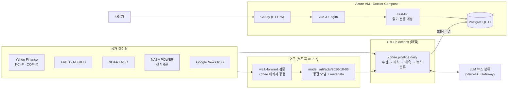

# 커피 원두 가격, 어디까지 예측할 수 있을까

> 20년치 공개 데이터로 **아라비카 커피 선물 가격이 5·20·60거래일 뒤 어느 범위에 있을지** 분석하고, 그 예측을 매일 자동으로 공개하는 1인 데이터 분석 프로젝트입니다. 데이터 수집부터 분석, 검증, 자동화, 대시보드 운영까지 혼자 진행했습니다.

**[▶ 운영 중인 대시보드 보기](https://coffee-price-sjinie.koreacentral.cloudapp.azure.com/)** · [매일 자동 실행 기록](https://github.com/sjinie/Coffee_Price_Prediction/actions/workflows/daily.yml) · [분석 노트북](notebooks/) · [개발 기록](docs/development_log.md) · [구조 문서](docs/architecture.md)

[](https://coffee-price-sjinie.koreacentral.cloudapp.azure.com/)

*실제 운영 화면입니다(2026-11-11). 2026-11-10 종가 기준으로 20거래일 뒤 가격이 244–315센트/파운드 범위에 있을 것으로 예측했습니다. 이미지를 누르면 지금의 대시보드로 이동합니다.*

## 한눈에 보기

| 분석 기간 | 다룬 데이터 | 예측 범위 적중률 | 운영 |
|:---:|:---:|:---:|:---:|
| **20년+** | **변수 67개** | **82%** | **매일 자동** |
| 2005년부터의 일별 자료 | 가격·환율·기후·뉴스 등<br/>공개 데이터 출처 5곳 | 목표 80%<br/>2012–2021년 검증 | 2026년 10월부터 |

### 이 프로젝트의 핵심 네 가지

1. **"얼마가 될까"에서 "어느 범위일까"로 질문을 바꿨습니다.** 가격 하나를 맞히려는 예측은 "가격이 지금 그대로일 것"이라는 가장 단순한 예측을 이기지 못했습니다. 그래서 원두를 사는 사람에게 실제로 필요한 **가격 범위와 오를 가능성**으로 목표를 다시 잡았습니다.
2. **예측되는 것과 안 되는 것을 데이터로 가려냈습니다.** 가격이 오를지 내릴지는 맞히기 어려웠지만, **평소 얼마나 크게 출렁이는지**는 단순한 방법보다 오차를 최대 25% 줄여 가늠할 수 있었습니다.
3. **잘못된 데이터 하나까지 추적했습니다.** 잘못 기록된 환율 값 하나가 예측 전체를 망가뜨리는 것을 찾아냈고, 실제 자료로 여러 규칙을 비교해 걸러 내는 기준을 정했습니다.
4. **분석을 매일 돌아가는 서비스로 만들었습니다.** 수집, 예측, 화면 갱신이 매일 자동으로 이어지고, 예측이 실제로 맞았는지도 대시보드에서 공개 채점합니다.

| | |
|---|---|
| **풀려는 문제** | 카페는 원두를 몇 주에서 몇 달 앞서 계약합니다. 그때 필요한 것은 가격 하나가 아니라 **가격이 움직일 범위와 오를 가능성**입니다 |
| **데이터** | 2005년부터의 커피 가격, 환율, 금리, 유가, 해상 운임, 산지 6곳의 날씨, 엘니뇨·라니냐 지수와 2022년 이후 뉴스 1,446건 |
| **분석 방법** | 미래 정보가 섞이지 않도록 자료마다 쓸 수 있는 시점을 정했고, 과거 자료로 학습해 그다음 해를 맞혀 보는 검증을 10년에 걸쳐 반복했습니다 |
| **결과물** | 가격 범위·상승 확률·매수 신호·위험 수준을 매일 내는 예측 모델과, 그 근거와 적중 기록을 보여 주는 대시보드 |
| **역할·기간** | 1인 프로젝트 · 2026년 9월 12일–10월 6일 개발, 이후 매일 운영 중 (2025년 학부 캡스톤을 처음부터 다시 설계) |
| **사용 기술** | Python · pandas · scikit-learn · LightGBM · SciPy · PostgreSQL · FastAPI · Vue 3 · Docker · GitHub Actions · Azure |

## 분석으로 알아낸 것

### 1. 가격을 직접 맞히는 것은 어려웠습니다

여러 예측 모델(Ridge, LightGBM, LSTM)을 시험했지만, 어느 것도 **"가격이 지금 그대로일 것"이라는 가장 단순한 예측**을 뚜렷하게 앞서지 못했습니다. 딥러닝 모델(LSTM)은 20일 뒤 예측에서 오차가 오히려 17% 더 컸습니다. 복잡한 모델이 늘 답은 아니라는 것을 숫자로 확인했고, **예측 목표 자체를 바꾸기로 했습니다.**

### 2. 대신 "얼마나 출렁이는지"는 가늠할 수 있었습니다

가격이 어느 쪽으로 갈지는 몰라도, **요즘 가격이 얼마나 크게 출렁이는 시기인지**는 최근 움직임으로 가늠할 수 있었습니다. 최근 5일·20일·60일의 변동 폭을 함께 보는 모델은, 직전 변동 폭을 그대로 쓰는 방법보다 오차가 5일 기준 25%, 20일 기준 14% 작았습니다(2012–2021년 검증). 이 결과를 이용해 "20거래일 뒤 244–315센트"처럼 **가격이 들어갈 범위**를 예측합니다.


*실제 변동 폭(갈색)과 예측(파랑)입니다. 예측은 순간적인 급등락보다 평균적인 수준을 따라갑니다.*

### 3. 뉴스는 가격을 앞서지 않고 뒤따랐습니다

커피 관련 뉴스 1,446건을 언어 모델(LLM)로 분류해 점수를 매겼습니다. 뉴스 점수는 **기사가 나온 당일의 가격 움직임**과는 관련이 있었지만(상관 0.21), 그 뒤의 가격과는 뚜렷한 관련이 없었습니다. 뉴스는 이미 일어난 일을 설명할 뿐이라고 판단해, 예측에는 보조 정보 하나로만 썼습니다.


*뉴스 점수와 그 앞뒤 날짜 가격 움직임의 관련 정도입니다. 가장 높은 막대가 기사가 나온 날에 해당하고, 그 뒤(오른쪽)는 0 근처입니다.*

### 4. 날씨는 "평소와 얼마나 다른가"로 봐야 보였습니다

2021년 7월 브라질에 서리가 내려 커피 가격이 급등했습니다. 그런데 이때 평균기온은 평년보다 0.7℃ 낮았을 뿐이고, 최저기온이 5℃ 안팎 낮았습니다. 평균만 보면 놓치는 사건이었습니다. 그래서 기온과 강수를 값 그대로 쓰지 않고 **직전 10년의 같은 시기와 비교한 차이**로 바꿔 넣었습니다.


*2021년 7월 브라질 서리. 가격(선)이 급등한 시기에 최저기온이 평년보다 크게 낮았습니다(막대).*

### 5. 잘못된 값 하나가 예측을 망가뜨렸습니다

범위 예측 모델의 첫 버전이 터무니없이 넓은 범위를 내놓아 원인을 추적했습니다. **1,910 안팎이던 콜롬비아 페소 환율이 하루만 3.67로 잘못 기록**돼 있었습니다. 흔히 쓰는 이상치 규칙을 그대로 적용하면 페소 환율의 하루 변화 가운데 7.9%가 이상치로 잡혔습니다. 그래서 실제 자료로 여러 규칙을 비교해 기준을 정했고, 최종적으로 고친 값은 20년치 자료에서 18개뿐입니다.

분석 과정은 노트북 [01 탐색](notebooks/01_data_and_eda.ipynb) → [02 변수 선택](notebooks/02_feature_selection.ipynb) → [03 가격·방향 예측](notebooks/03_return_direction.ipynb) → [04 변동 폭 예측](notebooks/04_volatility.ipynb) → [05 뉴스](notebooks/05_news_signal.ipynb) → [07 범위 예측 모델](notebooks/07_distribution_model.ipynb) 순서로 볼 수 있습니다.

## 여기까지 온 과정

처음부터 지금 모습이었던 것은 아닙니다. 방향을 바꾼 순간만 추렸고, 전체 기록은 [개발 기록](docs/development_log.md) 31건에 남겼습니다.

| 시기 | 무슨 일이 있었나 | 그래서 무엇을 바꿨나 |
|---|---|---|
| 2025년 학부 캡스톤 | 딥러닝 모델로 14일 뒤 가격을 예측했습니다 | 다시 보니 비교할 기준이 없었고 미래 정보가 섞여 있었습니다. **평가 방법부터 다시 설계**하기로 했습니다 |
| 2026년 9월 | 모델 6개와 뉴스 활용법 4가지를 비교했습니다 | 가장 좋은 모델이 기간마다 달라졌고, 모델 둘을 섞는 방법은 검증에서만 좋았습니다. **겉보기 성적을 그대로 믿지 않기로** 했습니다 |
| 9월 말 | 매일 도는 자동 작업이 5번 연속 실패로 표시됐습니다 | 5번 중 4번은 보조 뉴스 자료 하나가 막힌 탓이었고, 가격 예측은 저장됐는데도 실행 전체가 실패로 기록됐습니다. 보조 자료의 문제는 **'경고'로 따로 구분**하게 바꿨습니다 |
| 10월 초 | 코드를 전부 다시 쓰고 검증 방식을 바꿨습니다 | 실험 코드가 뒤섞여 설명하기 어려웠습니다. **읽고 설명할 수 있는 코드**를 기준으로 다시 쓰고 자료를 2005년까지 늘렸습니다 |
| 10월 초 | 코드 리뷰에서 평가 오류를 찾았습니다 | 60일 예측 평가에서 해마다 10–12월이 빠져 있었습니다. 고치자 60일 예측의 성적 지표가 0.655에서 0.601로 내려갔지만, **분석 전체를 다시 실행**해 설정을 처음부터 다시 골랐습니다 |
| 10월 5–6일 | 범위 예측 모델의 첫 버전이 실패했습니다 | 원인 세 가지를 찾아 고친 두 번째 버전을 서비스 모델로 확정했습니다 |
| 10월 5일– | 매일 운영하고 있습니다 | 예측을 쌓아 실제 가격과 비교해 채점하고 있습니다 |

## 대시보드

한 페이지에서 오늘의 예측, 예측이 만들어지는 과정, 데이터와 모델을 고른 이유, 실제 적중 기록을 차례로 보여 줍니다.

| 작동 방식: 그날 알 수 있던 값만 씁니다 | 데이터 탐색: 산지 날씨를 연도별 원형 차트로 |
|---|---|
|  |  |
| **검증 결과: 단순한 예측과 비교한 성적을 공개합니다** | **적중 기록: 실시간 예측을 따로 채점합니다** |
|  |  |

화면은 2026-11-11에 운영 사이트에서 캡처했습니다. 실시간 채점은 2026년 10월에 시작해 아직 쌓이는 중입니다(캡처 시점 5거래일 22건, 20거래일 7건).

## 결과를 믿을 수 있도록 지킨 원칙

- **가장 단순한 방법과 늘 비교했습니다.** 가격 예측은 "지금 가격 그대로", 변동 폭 예측은 "직전 변동 폭 그대로"와 같은 날짜에서 나란히 비교했습니다.
- **미래 정보가 섞이지 않게 했습니다.** 경제 지표는 발표 다음 날부터, 날씨는 관측 4일 뒤부터 쓰는 식으로 자료마다 쓸 수 있는 시점을 정했습니다.
- **과거로 학습하고 미래를 맞혔습니다.** 2012–2021년 10년 동안, 해마다 그 전까지의 자료로만 학습해 그해를 예측했습니다.
- **판단 기준을 결과보다 먼저 적었습니다.** 어떤 조건이면 채택할지를 계산 전에 노트북에 적어 두었습니다.
- **결과를 본 뒤에는 예측을 고치지 않습니다.** 예측은 결과가 나오기 전에 확정해 저장하고, 실제 가격이 나온 뒤에 따로 채점합니다.

<details>
<summary><b>실무자를 위한 상세 지표와 용어</b> (펼쳐 보기)</summary>

<br/>

**예측 대상.** 기준일 종가 대비 h거래일 뒤 종가의 로그수익률 ln(P<sub>t+h</sub> / P<sub>t</sub>) 분포입니다. h는 5·20·60이고, 화면에서는 이 예측 기간을 '지평'이라고 부릅니다.

| 구간 | 기간 | 쓰임 |
|---|---|---|
| 개발 | 2012–2021 | 해마다 그 전까지로 학습해 그해를 예측했습니다(walk-forward 10회). 후보와 판단 규칙을 여기서 정했습니다 |
| 홀드아웃 (화면의 '보류') | 2022–2025 | 개발 구간에서 정한 규칙을 그대로 적용해 확인했습니다. 앞선 실험에서 이미 본 구간이라 참고 성적입니다 |
| 실시간 | 2026-10– | 모델을 고정한 뒤의 매일 예측을 대시보드에서 채점합니다 |

**서비스 모델 `2026-10-06`.** 예측 기간마다 가운데 값과 폭을 함께 예측하는 분포 모델 하나를 씁니다(y = μ(x) + σ(x)·Z). 범위·상승 확률·매수 신호·위험 수준이 모두 같은 분포에서 나옵니다. 성적은 CRPS(예측 분포가 실제 값에서 떨어진 정도, 낮을수록 좋음)로 쟀습니다.

| 예측 기간 | 80% 범위 적중률<br/>개발 / 홀드아웃 | 상승 확률 AUC<br/>개발 / 홀드아웃 | 기준선 대비 CRPS<br/>개발 / 홀드아웃 |
|---|---|---|---|
| 5일 | 82.7% / 78.2% | 0.53 / 0.52 | +0.2% / −0.3% |
| 20일 | 82.4% / 79.0% | 0.56 / 0.58 | +1.4% / −1.1% |
| 60일 | 82.1% / 74.3% | 0.64 / 0.63 | +2.1% / −2.8% |

- **기준선.** 수익률은 현재가 유지, 변동성은 직전 변동성, 범위는 현재가에 HAR 변동성 폭을 더한 것입니다. CRPS 열은 +면 기준선보다 나쁘고 −면 좋다는 뜻입니다.
- **범위 예측.** 분포 모델이 기준선보다 낫다는 것은 확인되지 않았습니다. 개발 구간에서는 조금 나빴고(20일만 우연을 넘는 차이) 홀드아웃에서는 조금 좋았습니다. 기준선이 이미 HAR 변동성 폭을 쓰므로 변동성 예측의 이득은 기준선에도 들어 있습니다. 분포 모델을 쓰는 이유는 범위·확률·신호를 한 모델에서 어긋남 없이 내기 위해서입니다.
- **변동성.** HAR은 로그 변동성 RMSE를 직전 변동성 대비 5일 25%, 20일 14% 줄였습니다(2022–2025에는 27%, 20%). 60일은 차이가 뚜렷하지 않았습니다. 2022–2025의 개선은 평균 수준을 더 잘 맞춘 효과이고, 급등락 시점을 맞힌 것은 아닙니다.
- **미래 정보 차단.** 목표일이 학습 구간을 넘는 행은 학습에서 뺐고(embargo), 모델 설정은 평가 연도 이전 성적으로만 골랐습니다(중첩 검증).
- **불확실성.** h일 수익률은 날짜가 겹치므로 블록 bootstrap 1,000회로 95% 구간을 계산했습니다.
- **판단 규칙 고정.** 후보와 채택 기준을 계산 전에 노트북 첫 셀에 적고 SHA-256으로 고정했습니다. 분포 모델 v2는 v1의 결과를 본 뒤 고친 것이라 개발 구간도 두 번째로 본 것입니다.
- **매수 신호.** 20일에서만 냅니다. 개발 구간 시뮬레이션에서 신호대로 사면 정기 구매보다 평균 0.16% 쌌고, 같은 자료로 기준을 골라 그 우위는 검증 전입니다. 그래서 화면은 신호보다 범위를 먼저 보여 줍니다.
- **자료의 한계.** 공개 기록이 없는 과거 경제 지표와 2026년에 한꺼번에 분류한 과거 뉴스는 쓸 수 있었던 시점을 가정했습니다(뉴스는 발행 다음 날). Yahoo KC=F는 근월물 연결 가격이라 만기 교체 때의 가격 점프가 섞여 있습니다.
- **추가 노트북.** 수익률 재설계는 [03b](notebooks/03b_return_redesign.ipynb), 뉴스 보정 재시험은 [05b](notebooks/05b_news_correction.ipynb)에 있습니다.

</details>

## 데이터가 흘러가는 길



- **매일 자동으로 돕니다.** 공개 데이터 출처 5곳에서 자료를 모아 예측을 만들고 데이터베이스에 저장하면, 대시보드가 그 값을 보여 줍니다.
- **작은 문제가 전체를 멈추지 않습니다.** 뉴스 같은 보조 자료가 실패해도 가격 예측은 저장되도록 실패를 경고와 중단으로 나눴습니다.
- **분석과 서비스가 같은 코드를 씁니다.** 노트북에서 검증한 계산을 서비스가 그대로 쓰고, 두 결과가 같은지 확인했습니다.
- **테스트 111개로 지킵니다.** "기준일 이후의 자료를 모두 바꿔도 기준일까지의 계산 결과는 같다"는 성질까지 테스트로 고정했습니다.

<details>
<summary><b>자료별 사용 시점</b> (펼쳐 보기)</summary>

<br/>

| 자료 | 언제부터 쓰는가 |
|---|---|
| KC=F 종가 (Yahoo) | 당일 23:00 UTC 마감 이후 |
| 페소 환율 COP=X (Yahoo) | 관측 다음 날 |
| 헤알 환율·금리·유가·운임 (FRED·ALFRED) | 최초 공개일 다음 날 (공개 기록이 없는 구간은 공개 지연을 가정) |
| ENSO (NOAA) | 3개월 계절이 끝난 다음 달 11일 |
| 산지 강수·기온 (NASA POWER) | 관측일 + 4일 |
| 뉴스 점수 (Google News → LLM 분류) | 분류가 끝난 뒤 첫 거래일 마감 |

종료 코드는 성공 0 / 경고 3 / 실패 1이고, LLM 뉴스 분류는 하루 2건, 누적 1 USD 상한 안에서 돕니다. 자세한 구조는 [architecture.md](docs/architecture.md)에 있습니다.

</details>

## 이 프로젝트로 보여 드리고 싶은 역량

| 역량 | 이 프로젝트에서 한 일 |
|---|---|
| 문제 정의 | 맞히기 어려운 "가격 하나" 대신, 구매자에게 필요한 "범위와 가능성"으로 질문을 다시 세웠습니다 |
| 데이터 품질 관리 | 잘못 기록된 값을 찾아 원인을 추적하고, 실제 자료로 규칙을 비교해 기준을 정했습니다 |
| 분석 설계 | 단순한 예측과의 비교, 과거로 학습해 미래를 맞히는 검증, 결과보다 먼저 적은 판단 기준을 지켰습니다 |
| 근거 있는 판단 | 뉴스 보정, 모델 섞기, 딥러닝처럼 좋아 보이는 방법도 숫자가 받쳐 주지 않으면 채택하지 않았습니다 |
| 자동화와 운영 | 매일 도는 수집·예측 작업, 테스트 111개, 자동 검사(CI)를 갖추고 실제로 운영하고 있습니다 |
| 전달 | 예측과 근거, 검증 성적을 한 화면에서 설명하는 대시보드를 만들었습니다 |

## 직접 실행해 보기

<details>
<summary><b>설치와 실행 명령</b> (펼쳐 보기)</summary>

<br/>

`.env.example`을 `.env`로 복사해 값을 채웁니다(`FRED_API_KEY`, `AI_GATEWAY_API_KEY`, `DATABASE_URL`, `POSTGRES_PASSWORD`).

```bash
# 환경 (Python 3.12)
uv venv --python 3.12 "$HOME/.virtualenvs/coffee-price-prediction"
uv pip install --python "$HOME/.virtualenvs/coffee-price-prediction/bin/python" -r requirements.txt
source "$HOME/.virtualenvs/coffee-price-prediction/bin/activate"

python -m pytest            # DB 없이 72 passed · COFFEE_TEST_DATABASE_URL을 주면 89 passed
python -m coffee.sources    # 원자료 수집 → data/sources/*.parquet

# 로컬 전체 실행 (PostgreSQL + API + 대시보드 → http://localhost:8080)
docker compose up -d --build
docker compose run --rm pipeline migrate
docker compose run --rm pipeline backfill
docker compose run --rm pipeline daily      # 기준일의 예약 시각(종가 다음 날 06:17 UTC) 전이면 건너뜀

# 프론트엔드
cd frontend && npm ci && npm test && npm run build
```

수집 데이터(`data/`)는 저장소에 넣지 않았습니다. 노트북은 번호 순서로 실행하되 07 다음에 06을 실행합니다(07이 고른 설정을 06이 동결). 배포 절차는 [architecture.md](docs/architecture.md#배포와-되돌리기)에 있습니다.

</details>

```
coffee/              수집·피처·평가·모델·뉴스·DB·파이프라인·API (노트북과 서비스 공용)
notebooks/           01–07 분석 노트북과 결과 JSON
model_artifacts/     동결 모델(2026-10-06)과 metadata
frontend/            Vue 3 대시보드 (차트 라이브러리 없이 SVG)
tests/               시점 성질·평가·파이프라인·DB 계약 테스트
deploy/, .github/    VM 배포 설정, CI와 일일 배치 워크플로
docs/                architecture.md(구조·데이터 계약), development_log.md(의사결정 기록 31건)
```

## 앞으로 할 일

- 실시간 예측이 더 쌓이면 범위와 신호의 적중률을 같은 기준으로 다시 검증하겠습니다.
- 2026년 10월 초까지의 자료로 다시 확인했을 때는 범위 적중률이 62–76%로 목표보다 낮았습니다. 범위의 폭을 다시 맞추는 것이 다음 버전의 과제입니다.
- 선물 가격은 카페가 실제로 내는 납품가와 다릅니다. 이 예측은 구매 판단의 참고 지표로 만든 것입니다.

이 프로젝트는 투자 조언이 아닙니다.
